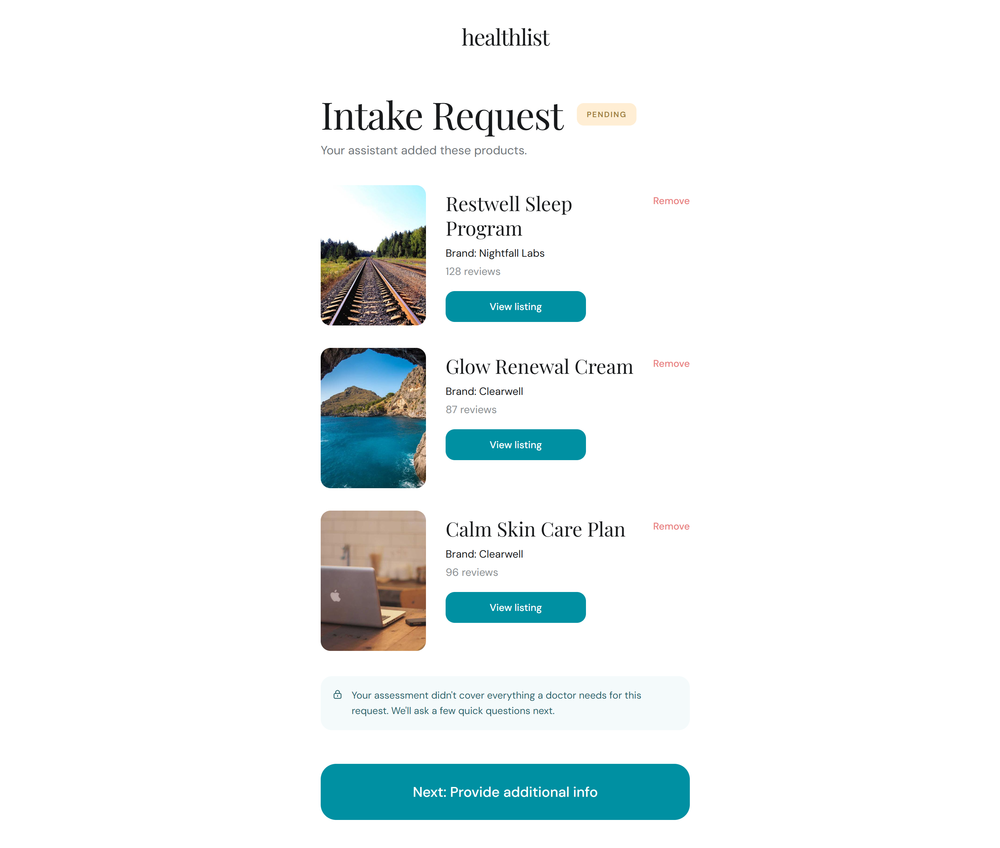
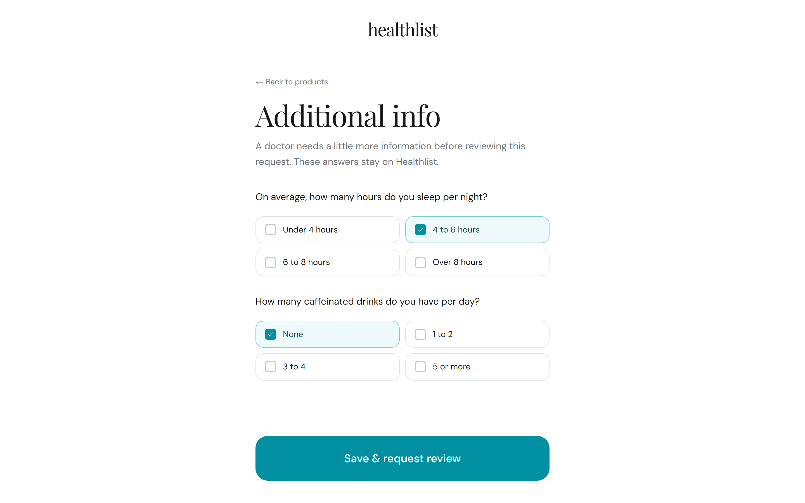
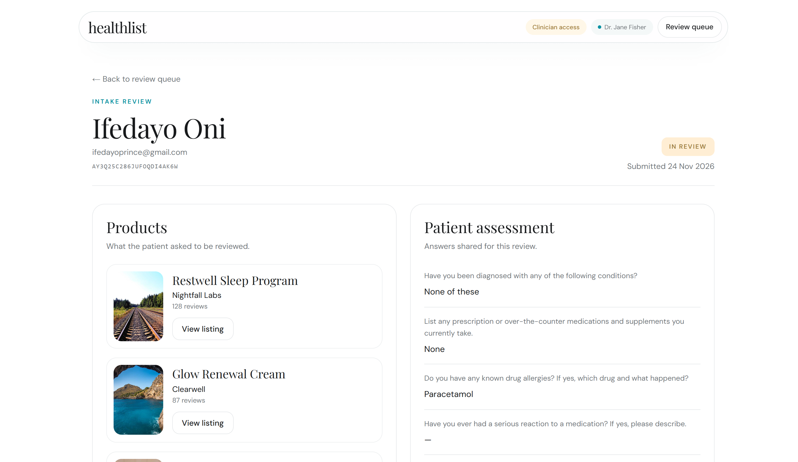
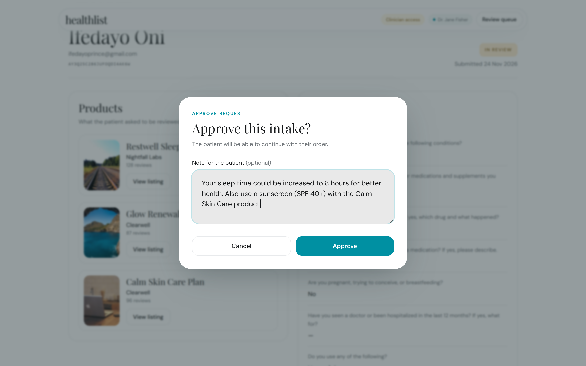
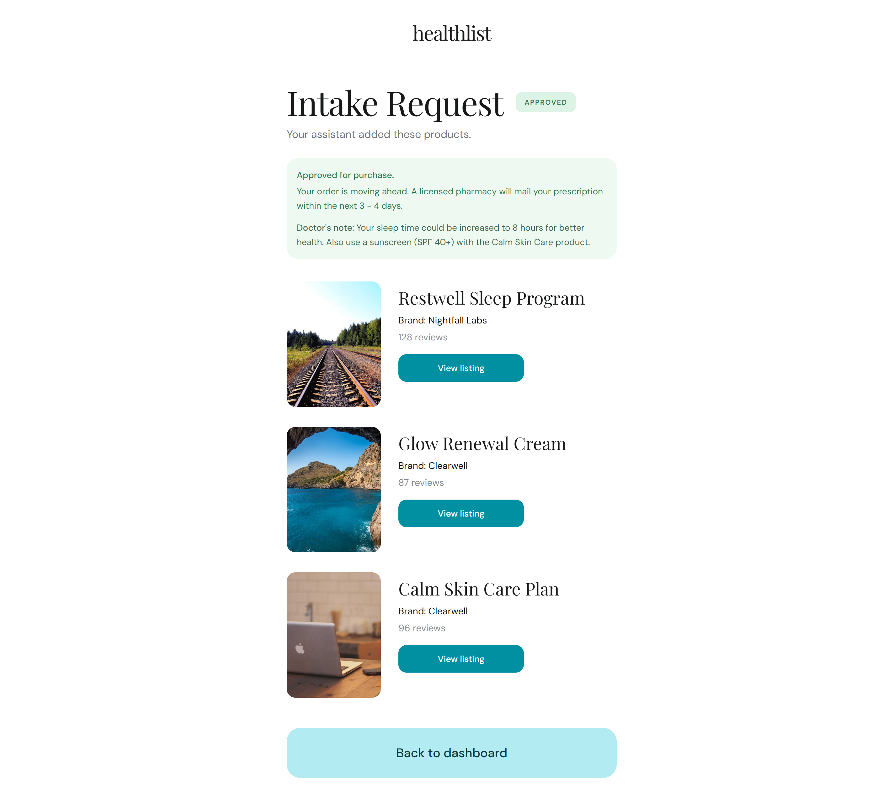

# Healthlist

**A telehealth marketplace that feels like a small world — just you, your assistant, and your doctor.**

Healthlist is a proof of concept for a different kind of marketplace. Instead of a giant storefront with a catalogue to scroll, discovery happens inside the user's AI assistant. The products land on one quiet, personal page where the user reviews them, answers a few health questions, and sends the request to a doctor.

Inspired by the vision behind **Bask.Health's acquisition of Telehealth.com**.

> This is a proof of concept. It uses fictional products and is not a medical service or a production-ready health platform.
> Not affiliated with Bask.health or telehealth.com

## What it looks like

**The patient opens the link their assistant created, checks the products, and answers a few extra questions.**

<table>
  <tr>
    <td width="50%"></td>
    <td width="50%"></td>
  </tr>
  <tr>
    <td><sub><b>1. The request.</b> The assistant's picks land on one page. The patient can remove anything they don't want.</sub></td>
    <td><sub><b>2. A few more questions.</b> If the products need more context, the patient answers before submitting.</sub></td>
  </tr>
</table>

**A doctor sees the products and the patient's answers side by side, then approves or declines with a note.**

<table>
  <tr>
    <td width="50%"></td>
    <td width="50%"></td>
  </tr>
  <tr>
    <td><sub><b>3. Clinical review.</b> Products on the left, the patient's assessment on the right — the whole decision in one view.</sub></td>
    <td><sub><b>4. The decision.</b> Approve or decline, with an optional note that goes back to the patient.</sub></td>
  </tr>
</table>

**The patient sees the outcome and the doctor's note on the same link.**

<p align="center">
  
</p>

## The idea

- The assistant does the searching and comparison.
- The user sees only the few products that matter to them.
- Sensitive health data never goes to the assistant.
- A doctor reviews the final plan with both the products and the patient's answers in one view.
- The whole experience is one continuous flow, not a catalogue with a checkout bolted on.

The MCP server is the front door to the market. The web app is the private room where the important parts happen.

## What is in this repo

| Directory | What it is |
| --- | --- |
| `api/` | NestJS API: auth, assessments, listings, intakes, doctor console, Drizzle schema, migrations, seed data. Hand-written. |
| `mcp/` | MCP server exposing `search_market`, `fetch_listing`, and `create_session` to an AI assistant. Hand-written. |
| `web/` | Next.js patient and clinician app. Built with a coding agent from Figma reference designs. |
| `images/` | Screenshots of the finished flows, plus the original Figma references and a Sketch draft used to build the web app. |
| `METHODOLOGY.md` | The original thinking behind the PoC, flows, and known gaps. |

## Architecture

```text
Assistant (ChatGPT, Claude, or any MCP client)
        │
        │  MCP tools: search_market / fetch_listing / create_session
        ▼
   mcp/  (MCP server, :3005/mcp)
        │
        │  server-to-server, mcp-token header
        ▼
   api/  (NestJS, :3001) ──────────  PostgreSQL + ParadeDB (:5432)
        ▲
        │  /api/* proxy, httpOnly `sid` cookie
        │
   web/  (Next.js, :3000)
```

- The assistant talks to the MCP server, never directly to the API.
- The MCP server authenticates to the API with a shared token and an optional IP allowlist.
- The web app proxies `/api/*` through Next.js so the session cookie stays same-origin.
- Search runs in PostgreSQL via ParadeDB's `pg_search` BM25 indexes.

## Documentation

| Document | Contents |
| --- | --- |
| [FLOWS.md](FLOWS.md) | The full product flow: discovery, handoff, assessment, intake, clinical review, decision. |
| [DATA_MODEL.md](DATA_MODEL.md) | Tables, intake statuses, question types, listing documents, and search indexing. |
| [API.md](API.md) | Endpoint reference, access rules, authentication, and MCP tools. |
| [GETTING_STARTED.md](GETTING_STARTED.md) | Local setup, environment variables, demo accounts, checks, and troubleshooting. |
| [METHODOLOGY.md](METHODOLOGY.md) | The original PoC thinking and known gaps. |

## Tech stack

| Layer | Stack |
| --- | --- |
| API | NestJS 12, TypeScript, Drizzle ORM, PostgreSQL via ParadeDB, Argon2, Winston, class-validator, envsafe |
| Search | ParadeDB `pg_search` with BM25, fuzzy matching, field boosts, and JSONB metadata filters |
| MCP | TypeScript, `@modelcontextprotocol/server`, Express transport, Zod, Axios |
| Web | Next.js 16.4 (App Router, Turbopack), React 19.3, Tailwind CSS 4, TypeScript |
| Tooling | pnpm, Docker Compose, Vitest, oxlint, ESLint |

## What is mocked or out of scope

- **Payment methods** are stored in browser local storage and never charged.
- **Listings** are seeded. There is no seller, admin, or CMS flow yet.
- **Assessment logic** is a fixed question set, not a decision tree.
- **Notifications** to WhatsApp/Telegram are not implemented.
- **Shipping, pharmacy fulfilment, and charging** do not exist.
- **Email verification, password reset, and account recovery** are not implemented.
- The platform is not production-compliant for real health data. Use fictional data only.
- **Improved search algorithm** using pgvector and reranking.

## Design references

The screenshots above live in [`images/screenshots/`](images/screenshots). The original Figma exports and the Sketch draft used to build the web app are in [`images/`](images).

## Credits

- Concept, API, and MCP server: hand-coded.
- Web app: built with a coding agent from the author's Figma designs.
- Inspired by the vision behind Bask.Health's acquisition of Telehealth.com.

---

**Healthlist is a proof of concept.** It explores how a marketplace can feel personal, how an assistant can act as the front door, and where the human clinician still belongs.
